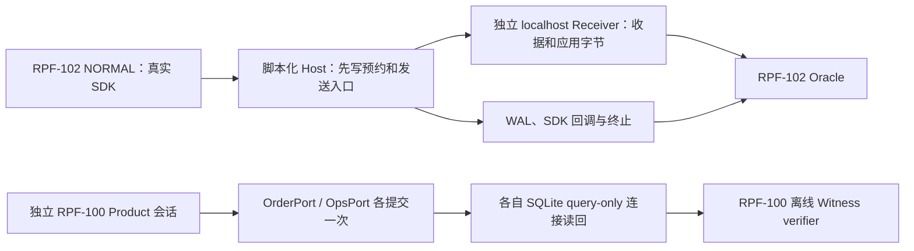
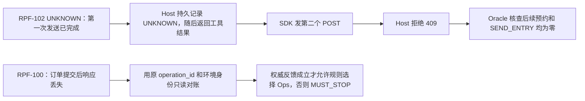

# RPF-103 · 公开 SDK 证据归档与产品接入边界

原始 [Run 42631302508](https://github.com/MyKr-YSteinsK/runproof/actions/runs/42631302508) 与 [Artifact 13681255432](https://github.com/MyKr-YSteinsK/runproof/actions/runs/42631302508/artifacts/13681255432) 来自 `cb181bcced89384cc1f2f9a3e7ec43d0456af34b` 的手动审批运行。归档 ZIP 逐字节匹配 GitHub，原链接有保留期限。

在仓库根使用已核验的 Python 运行：

```text
python -B -m ci.rpf103_verify_archive
python -B -m unittest -v ci.test_rpf103_verify_archive
```

验证器锁定 ZIP 和 Manifest 摘要，直接读取内存中的 ZIP 成员，校验公开投影与当期 Oracle 合同。它依赖归档时绑定的 RPF-102 源码身份。后续 RPF-102 源码发生变化时，使用本交付提交中的验证器与依赖复核。

## 已有证据流





| 角色 | 当前事实与信任边界 |
| --- | --- |
| EffectWriter | RPF-100 的 `Product.create` 冻结 session、订单和配置合同，派生各自的 `operation_id` 与 `environment_id`。Port 持有任务自有 SQLite 写权限并以操作身份唯一入账。RPF-102 SDK 只有本地 Host 准入凭据，其固定工具回调没有 SQLite 写权限。 |
| Explorer | RPF-100 的规则读取经校验的第一域反馈摘要再选择第二域。RPF-102 的 completion 来自脚本，未运行外部模型 Explorer。 |
| HostBarrier | RPF-102 的 Journal 绑定 owner、case、源码及预算，在返回 UNKNOWN 之前落盘闩锁。SDK 可看到工具结果，不能自行预约或清除闩锁。RPF-101 为另外的进程恢复证据。 |
| AuthorityReadOnly | RPF-100 的 Port 以 `mode=ro` 和 `query_only` 读取本域状态与收据并核对环境身份。RPF-102 Receiver 仅能证明传输字节。两者不能互替。 |
| Verifier | `product_local_verify` 复算冻结合同、权威快照、反馈和会话顺序，读取 Witness 字节。`sdk_presend_oracle` 复算 SDK 进程、票据、收据、字节和 UNKNOWN 顺序，读取公开 capsule。两者不持业务写权限。 |
| Issuer | 两条线均为 `NOT_ESTABLISHED`。GitHub 身份、摘要和内容核验只锚定当前公开来源。 |

`Product.open` 会取得 writer lock、建表并恢复未完成会话，`lookup` 使用普通连接，所以二者不适合作为纯只读适配器的启动入口。RPF-100 已发布结果记录了独立会话和 Witness 摘要，本轮允许读取的文件中没有该会话的原始 Witness 或 SQLite 字节。现有 Witness 的 `storage_owner` 是标签，`source` 是模块摘要，二者都不能补成 GitHub run/owner/SHA。现阶段增加适配器只能静态并列两个摘要，因此桥接代码为 `RECOMMENDATION`。

## 下一轮最小物理切片

1. 在新任务 owner 内冻结 `run_id`、`owner`、`source_git_sha`、两个 `operation_id`、目标环境身份、合同摘要、SDK/Host/Receiver/Authority 身份和单次预算。控制器持有映射。SDK 只获 scoped 工具凭据与调用 ID，禁止传入路径、SQLite 写权限、预约权限或控制器凭据。
2. 在新授权下修改 `sdk_presend_client.py` 的工具 schema，新增确定性调用映射。修改 `sdk_presend_host.py` 的工具入口，绑定调用 ID、轮次和冻结合同，先持久化 write intent 再执行固定目标操作。提供只读 `GET /operations/{operation_id}` 对账入口，按冻结映射查状态和唯一收据。Host 必须在已提交但响应丢失时先落盘 UNKNOWN，再向 SDK 暴露。重复、错域、错 owner、未冻结 ID 均在进入写口前拒绝。
3. 在 `product_local_ports.py` 分离初始化、写入和独立只读 Authority。为 `product_local_session.py` 增加受控的逐域执行入口，避免调用目前会自行完成两轮的 `Product.create`。同一 NORMAL run 先写 Order 并独立读回，再依据冻结反馈选 Ops，并各自验证一次提交。独立 UNKNOWN run 使用订单提交后真实响应丢失，确认只读对账，拦截同一闩锁内任何后续写入、预约和发送。当前只读确认可以产生反馈，不能解除发送闩锁。
4. 扩展 `sdk_presend_probe.py`、`sdk_presend_oracle.py` 与 `product_local_verify.py` 的新版本合同，验证同一 run 身份上的 SDK 调用、Host 意图、SQLite 收据、独立读回、发送证据和终态。负控覆盖错合同、重复写、错 owner/run/source、缺失读回、闩锁落盘失败或恢复、换收据和重锚后的 UNKNOWN 后预约/发送。无证据则拒绝或 `INCONCLUSIVE`。

未来若要在 Product Lab 引用已验证的 SDK 记录，建议只暴露经验证的投影与 `evidence_origin=RPF102_LOCAL_CONFORMANCE`、`provider_kind=SCRIPTED_LOCAL`、`product_effect=NOT_ESTABLISHED`。在独立产品 Witness 可读时，把两份 run/owner/source 分别保存。只有同一新运行的 Authority 与 Oracle 都成立后，才可标示实际产品效果。
