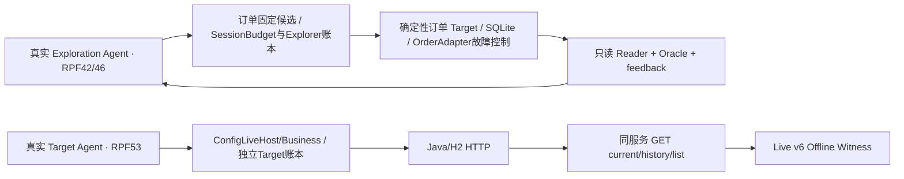
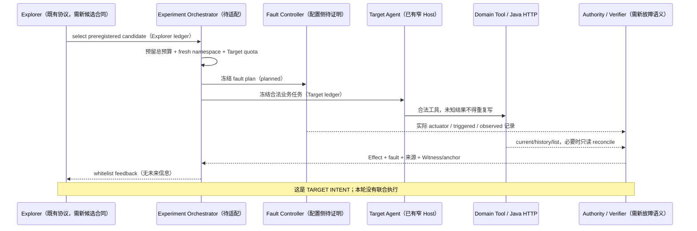

# RPF-54｜跨域 PGE 扩展可行性

## 结论与调查身份

**FACT：** 既有完整 Witness 可以投影为同一最小字段集合；生产执行接口不能直接拼接。**RECOMMENDATION：** 先做 B——配置适配层有界交付丢失、负控及只读 reconcile；再考虑 A 的真实 Explorer×Target 双 Agent 循环。C、D 保持候选。本报告不是下一份正式 Plan，不授权任何新 Provider、Java 或故障试验。

所有源码定位基于 `05b8c324fab376a23926b97a73e0fde6523ae373`；下面的代码本轮全部只读。成本和时间是基于明确修改面的工程软估计，不是实测工时、账单或承诺。

## 实际接口与责任映射

| 源码 / symbol / 定位 | 输入→输出、身份及预算 | 本轮核实的适用范围 / 扩展缺口 |
|---|---|---|
| [pge_contracts.py](../../runtime/runproof_runtime/effectwitness/pge_contracts.py#L24) `catalog` / `SessionPlan` L24/38 | 固定三候选、Execution/Effect/Experiment v2、session digest；2 trial/policy、4 physical、4 Explorer requests/12k tokens | 订单 CNY2500、deterministic Target、owner rpf-42；没有 HTTP config candidate 或真实 Target Provider 子预算 |
| [pge_provider.py](../../runtime/runproof_runtime/effectwitness/pge_provider.py#L56) `explore` / `parse_choice` L56/18 | `select_experiment(candidate_id)`→合法选择；第二请求回注已验证反馈与 Tool Call ID | 是 Explorer，不是受测 Target；提示及 enum 来源于订单 plan，不得注入后验答案 |
| [exploration.py](../../runtime/runproof_runtime/effectwitness/exploration.py#L39) `SessionBudget` / `ExplorationSession.execute` L39/238 | 会话持久预留 Provider/steps/trials；执行→feedback/hash/new_facts | `execute` 直接调用本模块订单 `run_trial`；target 为确定性，不能再挂一个独立满额 Provider ledger 而无总预算 |
| [exploration.py](../../runtime/runproof_runtime/effectwitness/exploration.py#L167) `project_feedback` | 订单三合同、owner、Reader、before/after、receipt、fault flags→`rpf-exploration-feedback-v1` | 精确检查 rpf-42、订单 Reader、receipt/activation。HTTP GET 摘要不是这个参数类型 |
| [cross_contracts.py](../../runtime/runproof_runtime/effectwitness/cross_contracts.py#L11) `CrossContracts` / [cross_core.py](../../runtime/runproof_runtime/effectwitness/cross_core.py#L14) `SPECS` | 静态 order/ops registry、`rpf-cross-execution-v1` / experiment v1；Provider=0 | ops 是 SQLite 配置模拟，不是 Java config-center。未知 domain 被拒绝，不能用域名选择任意导入或 URL |
| [cross_trial.py](../../runtime/runproof_runtime/effectwitness/cross_trial.py#L22) `run_trial` | contracts + storage_task→bundle/7步 usage；owner/reset/事件/cleanup | storage 仅 rpf-44/45/46；L39直接选择 Order/ Ops Sandbox/Reader/Adapter。不是可插拔 HTTP driver |
| [cross_core.py](../../runtime/runproof_runtime/effectwitness/cross_core.py#L102) `project_feedback` / `validate_bundle` | domain Effect+fault→`rpf-cross-feedback-v1`；v2 Witness 复算 Snapshot/receipt/events/digest | 可复用概念与校验逻辑；完整现行 v2 样本要求确定性 capture、对应 Reader、response-lost、唯一receipt及 reset。不能只改 source label |
| [lab_exploration.py](../../runtime/runproof_runtime/effectwitness/lab_exploration.py#L41) `freeze_plan` / `validate_plan` / `ExplorationStore` | 两轮预留 run、每轮候选合同、2 Provider/16steps/12k tokens；独立付费 quota | 固定 order、rpf46身份和 cross_trial；[lab_evidence.verify_session](../../runtime/runproof_runtime/effectwitness/lab_evidence.py#L57) 要求完整 plan、trials/contracts、全部 events。公开 research summary 不是该 Envelope |
| [engine.py](../../runtime/runproof_runtime/effectwitness/engine.py#L85) `Orchestrator`；[orders.py](../../runtime/runproof_runtime/effectwitness/orders.py#L30) Reader；[ops.py](../../runtime/runproof_runtime/effectwitness/ops.py#L150) Adapter | DomainPort/AuthorityPort、pending操作、收据 reconcile、受控事务后丢回复 | 窄协议可作设计参照；实现假设可重置 SQLite/operation receipt，不能直接宣称 H2 HTTP 有相同证明 |
| [config_live_contracts.py](../../runtime/runproof_runtime/effectwitness/config_live_contracts.py#L125) `make_contracts` / `validate_contracts` | 同级 Execution/Effect/Experiment v6；固定三工具、v1→v2、单 Trial、6请求/12k tokens/2POST | Target 合同，不含预注册 Explorer session/candidate、fault controller。L290后实验校验接受惰性额外 `fault` 键，但无使用语义；字段能通过不等于故障能执行 |
| [config_live_runtime.py](../../runtime/runproof_runtime/effectwitness/config_live_runtime.py#L267) `ConfigLiveHttp/Business/Host` L267/359/634 | 实际 SDK intents/callback/returns；父 Host ledger 与可见性；loopback HTTP→只读最终读回 | 是 Target Host，不能选择 PGE fault。写结果未知后 `stop_writes`；Agent 只有3工具，HTTP配置侧没有订单 `reconcile_order` 等价 Agent Tool |
| [config_live_verify.py](../../runtime/runproof_runtime/effectwitness/config_live_verify.py#L519) `validate_payload/verify_bytes/verify_file` | Live v6 Envelope+外部锚→确定性 Oracle；来源/SDK/请求/GET/argv/清理 | 可复用独立证据出口；当前无 fault provenance、session selection 或跨轮信息增益契约，不能签联合 PGE claim |
| [config_http_oracle.py](../../runtime/runproof_runtime/effectwitness/config_http_oracle.py#L117) `evaluate_config_effect`；[config_target_bridge.py](../../runtime/runproof_runtime/effectwitness/config_target_bridge.py#L204) `ConfigTargetToolHost` | 固定HTTP请求/状态/读回或SDK Fixture→受限业务结果 | stale 409/授权403是已有API语义；RPF52 scripted Fixture是无付费预演边界，不能替代真实模型选择 |
| [target_driver.py](../../runtime/runproof_runtime/effectwitness/target_driver.py#L166) `TargetToolHost` / `TargetAgentDriver`；[target_recovery.py](../../runtime/runproof_runtime/effectwitness/target_recovery.py#L174) verifier | 订单真实 Target 的 intent、UNKNOWN→reconcile、有限账本及恢复内容证明 | 可参照两 Agent身份与停止协议；逻辑/物理 owner、SDK和订单收据仍是窄合同，不是通用 MCP 执行器 |

### 至少四个不能直接拼接的实证

1. 纯协议负控实际调用 `SessionPlan.freeze/candidate`，真实 Target driver 或新 config candidate 被拒绝；不是给同名对象赋值就能新增候选。
2. `CrossContracts.create("config-http", ...)` 被静态 registry 拒绝；`cross_trial.run_trial(..., storage_task="rpf-54")` 在构造沙箱前拒绝。允许列表之外没有执行入口。
3. 订单 feedback 的 source/receipt/session/policy 与 Config Live v6 的同服务 GET、无 receipt/fault/session 不匹配。现有 Witness v2 的固定 deterministic capture 资格也不接受 Live v6 Envelope。
4. Config Live 额外 `experiment.fault` 的合成元数据可通过旧验证器，但投影仍为 `UNKNOWN`，不能声称触发；本轮未修改生产校验器。下一版应明确 fault schema 与 actuator/observation，避免未消费元数据被误读为能力。
5. 若被测服务或 Agent Host 不允许插入故障边界，就没有合法 actuator；此时只读旧证据不能制造故障生效证明，应停止在 `NOT_ESTABLISHED`，另批测试边界。

## 当前链与目标链

已证现状是两条相互独立的链；同图展示不表示历史运行互相调用：

目标时序中的 Adapter、故障激活和双角色预算是待授权的新工作：

## 候选故障与归因边界

| 候选 | 已有事实 | 未完成证明 / 首要风险 |
|---|---|---|
| stale expectedVersion | RPF51 Witness及Oracle验证409/code4091，最终状态不被覆盖 | API预期拒绝不是天然fault injection。若让模型故意违反冻结参数，是任务/模型参数错误；需要新预注册干预边界才能归因 |
| API授权拒绝 | RPF51已有403/code4031及之后状态未改变 | 不将非法凭据暴露给Target或使用生产凭据；拒绝本身不证明Agent发现故障或探索改选 |
| 局部交付丢失（推荐B） | 订单已知事务后丢回复机制可作参照，Config有stop_writes/只读读回 | 配置侧尚无actuator。可先在受控Host/Adapter收到HTTP200后抑制一次Tool返回，准确标记 `LOCAL_DELIVERY_SUPPRESSION_AFTER_HTTP_200`；不能称TCP网络断包 |
| 真正 transport response-loss / 竞态 | 当前配置Live没有对应触发记录或控制器 | 需另批代理/网络边界或独立writer；H2新namespace、可观察性、未知POST与因果配对复杂，不从历史样本推导可用 |

正常控制、planned-but-inhibited、实际生效必须分别保存。未激活不能记为Agent FAIL；无法读取Authority、usage未知或cleanup失败按 `PLATFORM_ERROR/INCONCLUSIVE` 处理，停止新业务并保留账本。没有无故障/未触发负控时保持 `CORRELATIONAL_ONLY`。

## 四候选排序与软预算

尺度：价值/可行性1～5（越高越好），风险1～5（越高越高风险）；数字是本轮基于源码修改面的判断，不是实验评分或项目工时记录。

| 排名 / 候选 | VALUE / FEASIBILITY / RISK | COST / 时间软估计 | 复用与必要变更 | TESTABLE_GATE | CORE / APPROVAL |
|---|---|---|---|---|---|
| **1 / B 有界干预与归因** | 5 / 4 / 3 | 中；1～3工程日；建议0 Provider/0tokens/¥0，至多3独立本地Java场景 | 复用SDK Fixture、HTTP读回、Verifier；新增受限Experiment Adapter、fault plan/事件及否定控制 | normal、planned-untriggered、一次局部丢返回；2POST上限、UNKNOWN只读reconcile；三分故障证据；负控不虚报TRIGGERED | 补CORE故障/Authority缺口；Java/副作用及新源码范围需下一Plan批准 |
| 2 / A 真实PGE驱动外部Target | 5 / 3 / 4 | 高；3～6工程日；建议两轮、总≤12 Provider请求、≤28k tokens、≤¥1，另批 | 复用选择协议和TargetHost；新session版本/候选合同、Experiment Adapter、双角色和总账、反馈与Witness联合验证 | 首轮反馈在次轮输入前冻结；允许合法重复；两模型身份/ledger分开；真实激活/读回可核验；不强制L2成功 | CORE；先依赖B证据，再冻结当日价格和明确API/Java预算，本轮未使用 |
| 3 / C Witness shrinking/reproduction | 3 / 3 / 3 | 中；2～4工程日；建议≤8个确定性replay，0Provider | 可复用验证器与RPF50已知失败；必须定义保持违规/触发的谓词和fresh环境 | 不能仅删JSON字段称shrinking；每步仍核验同一谓词，独立复现另计 | SHOULD/研究增强；需新重放授权；配置正常Witness无可缩减违规 |
| 4 / D 通用MCP/API接入 | 2 / 2 / 5 | 大；至少1～2周量级估计；费用/外部范围尚未定义 | 现有窄Driver只能作参照；新权限、认证、域、未知结果、证据协议 | 精确工具能力与只读/写隔离，schema/超时/重放/来源负控；跨服务不可隐含Release authority | `FUTURE / REQUIRES_USER_APPROVAL`；不为本轮添加第三域/生产特性 |

### 唯一推荐的下一切片：B

先采用**配置 Experiment Adapter，置于 ConfigLiveHost 之上并保持旧入口封闭**；不直接给 `cross_trial.SPECS` 塞入HTTP后端，也不扩充 durable worker。先以真实固定 SDK + scripted Target Fixture 完成3个fresh namespace的本地场景：normal、planned-but-inhibited、抑制一次update v2的Tool返回。建议每场景≤3工具、≤12业务HTTP、≤2POST；合计≤3 JVM、≤36业务HTTP、≤6POST，Provider/Token/费用为0。以上只是下一Plan预算建议。

判定 Gate：

1. 预注册 Execution/Effect/Experiment/FaultPlan 和环境/候选身份；不改变目标合法参数，不把参数错误包装成注入。
2. Wrapper保存收到HTTP200的摘要、准确抑制事件、planned/triggered/observed和一次执行计数；只读current/history/list支持状态事实，并保留同服务信任限制。
3. UNKNOWN 后新业务Tool均拒绝，Host执行有限只读reconcile；不可确认时隔离并停止，无自动POST，无崩溃后重放。
4. 未触发负控不能宣称TRIGGERED；API拒绝/平台传输错误/业务违规分别判定。新Witness需独立SHA及重算摘要的负控。
5. 同一条件下的配对控制只能支持该机制的限定干预结论；未满足完整控制链时不升级现有 `CORRELATIONAL_ONLY`。

需要下一Plan批准的是新增Adapter/合同/测试的精确路径、3个本地Java业务Trial及fault边界；没有额外产品取舍需要本轮实施。B通过后再审A，避免用付费双Agent试验排查尚未证明的故障执行链。

## 将来的双 Agent 总账与停止设计（建议）

Session持有独立Explorer ledger、每Trial Target ledger和不可重置的总账。先全局预留，再子账预留，再允许HTTPS或业务工具；未知usage按保守预留占用总额并停止新请求。物理Trial quota不能因新建Target budget恢复满额。

候选由受限Experiment Orchestrator静态分派；Target不可修改候选/Oracle/Release权威。崩溃或UNKNOWN副作用必须由所属namespace的只读reconcile决定终态；未确认时隔离并停止整个session的新写者。两Agent均不得通过重选candidate绕过pending操作或复用旧Run ID。此设计尚未实施或验收。
