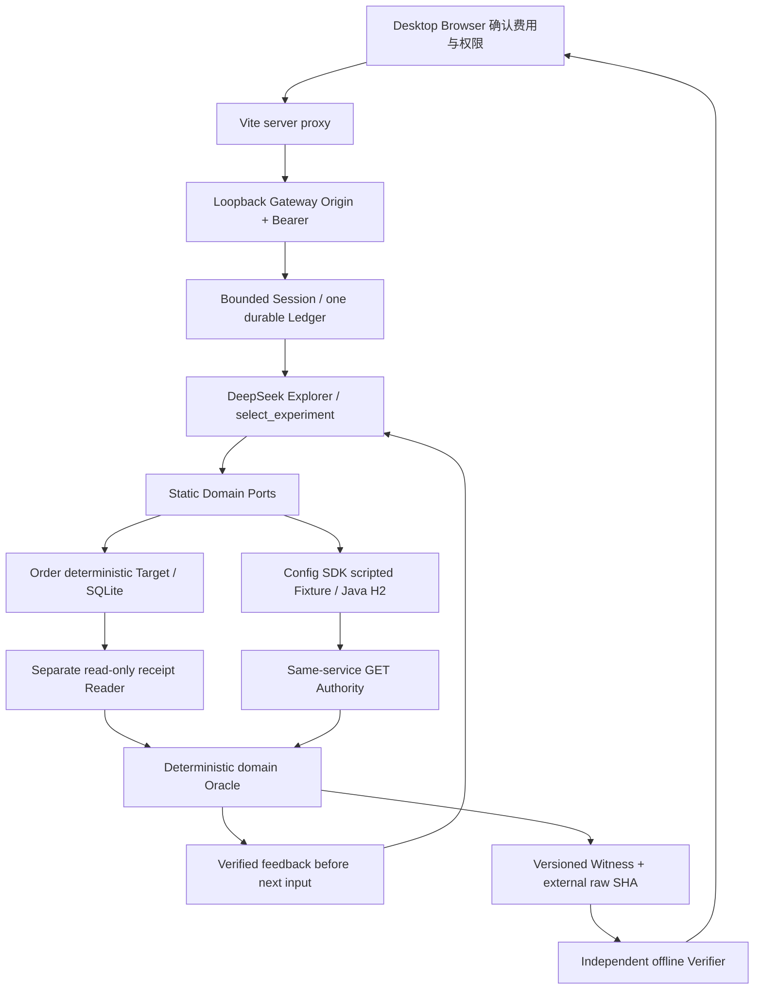

# 中文可复制申报文案

材料日期：2026-10-21；状态：未提交。以下长度是本包编辑目标，**不是门户已确认的字段上限**。作者、学校/单位、邮箱、团队成员均由用户填写。

## 作品名称

RunProof EffectWitness

说明性副标题：智能体行动副作用验证。门户作品名建议简洁且不含中文状态符号，因此标题字段优先只填上方英文名。英文说明：Proof-Guided Agent Action Validation。

## 短版（≤100字符）

面向Agent工程师，在受控退款与配置场景中，以有界探索、只读业务核验和离线Witness审查行动结果；真实Explorer已接入，Target来源分层，不承诺生产安全或因果优势。

## 标准概述（约300–500字符）

RunProof EffectWitness 面向开发会调用工具、改变业务状态的智能体的工程师与AI平台团队。请求成功或模型说“已完成”，不足以说明退款收据、配置版本与故障状态符合预期。作品在原RunProof平台内，将版本化执行、业务效果与实验合同连接起来：Explorer只能从冻结候选中选择实验，受控执行器完成业务，领域Authority只读获取状态，确定性Oracle检查合同，再把已验证反馈提供给下一轮选择。当前桌面浏览器已通过本机认证Gateway发起真实两轮会话，依次完成虚构订单2500分退款与Java/H2配置v2及历史[2,1]的核验，原始Witness可按固定SHA离线检查。该会话只有Explorer使用真实DeepSeek，订单Target确定执行，配置Target由真实SDK运行脚本化Fixture；配置故障未触发。创新集中在可核验副作用、受限选择与证据反馈的连接。工程价值是帮助研发和评审定位“结果是否有足够证据”，当前未证明普遍安全、反馈因果优势、生产能力或商业收益。

## 详细方案（约1000–1800字符）

当智能体开始退款、更新配置或触发运维操作，工程师需要判断的是业务最终状态。一次网络超时可能发生在提交之后；模型的完成声明与工具日志也可能不足以确认收据唯一、版本正确。RunProof EffectWitness服务Agent工程师、AI应用研发和平台可靠性团队，用受控实验回答“执行了什么、业务实际发生什么、验证能证明到哪里”。作品属于原RunProof可靠性与发布工程平台的竞赛增强切片，首要应用是研发沙箱和评审，尚未连接生产支付或生产配置。

核心设计把Execution、Effect和Experiment分别版本化，绑定运行、环境、源代码与Verifier身份。Execution描述可见的工具与执行过程，Effect固定业务前后状态和禁止结果，Experiment固定候选、故障计划与预算。真实DeepSeek Explorer仅可通过select_experiment在订单正常退款与配置planned-but-inhibited两个候选中选择；不能修改业务合同、预算、Oracle、源、端口或外部地址。同一账本先持久预约Provider与业务资源，再执行和结算；合法重复选择保留不同运行身份。遇到未知结果，流程保留预约并停止新写，只允许适用的只读对账；取消请求在安全边界生效，刷新和重启不会返还费用或自动续跑。

订单案例使用fresh SQLite、虚构2500分完整退款及唯一收据。与执行器分离的只读连接读取状态与收据，由非LLM的确定性Oracle核验。配置案例使用固定真实SDK、脚本化Target和fresh Java17/H2，执行inspect、create v1、update v2，并通过同服务GET读回v2与历史[2,1]。两个领域共享编排与账本，但保留各自Authority和语义；配置GET不被提升为数据库外部独立审计。故障计划、触发、观测分栏，未触发时明确显示NOT_TRIGGERED。

已实现的桌面Web以中英文展示来源、状态、Timeline、State Diff和事件深链。浏览器经Vite代理和loopback认证Gateway发起一次有意识确认的会话；服务端执行器持有权限，浏览器只取得有界DTO。RPF-60原会话中，Explorer两次实际选择订单后配置，2个Provider请求共1340 tokens，保守费用估算上界人民币0.007191元，属于该次调用估计而非产品价格或账单。订单与配置合同均满足，配置故障计划被禁用且没有激活；没有发现业务违规。首轮独立核验反馈先于次轮输入冻结，候选变化只作观察，不解释为反馈造成选择变化。

完整Witness保存两轮合法选择、反馈链、领域证据、故障标记、资源账本与来源限制。独立离线Verifier在不调用模型或重做业务的情况下检查文件内容、版本身份与合同一致性；缺失或错误外部SHA拒绝，重新计算摘要的语义篡改仍受到检查。浏览器另行核对下载原字节SHA，该步骤与离线语义验证分开。公开证书、固定提交链接和逐项Claim矩阵供评委追溯，hash不能充当发行者数字签名或独立复现实验。

独立的RPF-57配置研究会话使用真实Explorer和真实Target，观察了工具结果局部抑制及只读对账，并获得新增已验证事实。它提供配置域机制观察，不能与RPF-60镜头拼成同一场运行，也没有公平对照来证明因果或统计优势。当前未集成JiuwenSwarm/WorkSwarm，未建立两个真实LLM Target、数据库外部Authority、独立复现或生产就绪。后续应在明确授权下完善真实Target覆盖和公平对照；比赛前优先交付已能审查的提案、原始证据与诚实演示。潜在商业场景是Agent研发质量评审及故障排查，付费意愿、客户收益与规模性能仍待验证。

## 技术架构（当前真实链路）

图中独立指非LLM确定性验证过程及订单Reader分离；配置Authority仍为同服务GET。发布权限不属于被测Agent。潜在用户收益属于待验证价值假设，不填虚构客户或收益率。

## 供表单拆分粘贴的内容

| 常见材料名称（非门户字段确认） | 本文段落 |
|---|---|
| 项目简介 | 标准概述 |
| 应用场景/目标用户 | 详细方案第1、末段 |
| 技术方案 | 详细方案第2–5段及架构图 |
| 创新点 | 可核验行动副作用、版本化三合同、受限选择与已验证反馈、离线证据审查 |
| 功能/完成度 | 桌面入口、真实Gateway会话、订单/配置Oracle、新Witness；限定Target等级 |
| 风险/局限 | 详细方案最后两段及Claim矩阵 |
| 作品/代码URL | 下方固定功能快照，不要填main或本地地址 |

## 公开证据入口

- [固定功能快照](https://github.com/MyKr-YSteinsK/runproof/tree/1125e4e6ddc0ec3a0e5820ce6095b663354a4ec8)
- [RPF-60 真实浏览器会话报告](https://github.com/MyKr-YSteinsK/runproof/blob/1125e4e6ddc0ec3a0e5820ce6095b663354a4ec8/spikes/rpf-60/RESULT.md)
- [RPF-60 原始Witness](https://github.com/MyKr-YSteinsK/runproof/blob/1125e4e6ddc0ec3a0e5820ce6095b663354a4ec8/spikes/rpf-60/cross-domain-live-evidence.json)
- [Claim→来源→限制](CLAIM_EVIDENCE_MATRIX.md)
- [英文等价版本](SUBMISSION.en-US.md)
