# TASK_RESULT — RPF-70/rev-1

**Plan ID:** RPF-70

**Revision:** rev-1

**Status:** Partial

分支 `codex/rpf-70-owner-source-runtime-seam`；root `D:/CS/runproof`；Base `86b033b94556c0931aa590c79e69fda672a4915e`。本报告的实现与实测仅对应当前新分支，main 的既有 Project State 保持原字节；阶段推进及证据接受仍由 Architect 决定。

## 1. 验收与来源

| Gate | 结果 |
|---|---|
| G0 | PASS |
| R70-A01 | PASS |
| R70-A02 | PASS |
| R70-A03 | PASS |
| R70-A04 | PASS |
| R70-A05 | PASS |
| R70-A06 | PASS |
| R70-A07 | PASS |
| R70-A08 | PASS |
| R70-A09 | PASS |
| R70-A10 | NOT_RUN |

新执行 Source raw/LF digest：`f569d6624e834c2560b96ba53f94f34ae945fba8df715b39f875d6b79480d1c2`（本机 36 项源码均 LF，raw digest 同值）。其中 9 项为本轮新执行源，27 项为 Base 原字节只读复用。完整 map、SDK/JAR pin 及 declared/observed 一致性见 `source-identity-map.json`。

G0 的 RPF-69 原锚抄录冲突已由用户单独授权更正本轮预期值：`15d714a39118746c5d7d8787ef314c8b0bb8d70e792705c606457e9b2e4d14be`。未修改 Plan、原 manifest 或原 verifier。原 CLI 对实际值/缺值/错值分别返回 0/2/3。

当前源码未迁移旧历史证书；RPF66/67/68 三原件、19 项其他历史及 Reviewed/Public 共 24 入口重新通过原生 CLI；另有 RPF69 原 CLI 0/2/3。各命令原 SHA、PID、退出码和日志 SHA 见 `verification-diagnostic.json` 的 historical。

## 2. 对象与实际执行方向

```mermaid
flowchart LR
  O["OwnerScope v1: fresh rpf70 run/root"] --> S["SourceCapsule v1: declared vs observed raw/LF + SDK/JAR pins"]
  S --> A["AuthorizedOperation: immutable canonical bytes"]
  A --> G["Gate: typed Context + domain/role/lineage/once/UNKNOWN"]
  G --> P["new Guarded Port prepare / allowed / invoke / business"]
  P --> N["frozen native Driver + SDK child + HTTP/SQLite algorithms"]
  N --> Q["controller Authority: HTTP GET / SQLite mode=ro"]
  Q --> V["task-only verifier + cleanup"]
  V --> F["VerifiedFeedback frozen in same physical WAL"]
  F --> M["raw-anchored local manifest; no Issuer"]
```



`OwnerScope`、`SourceCapsule`、`AuthorizedOperation` 是新类型；`Context` 是 task-owned 新装配，未使用旧 Context/root alias。`Guarded` 的实际 MRO 包装 native ConfigPort 与窄 Order 构造器。prepare 的授权先于 JVM/SQL setup；invoke 的授权带原 response/call ID；business 入口再次确认 active operation 并先永久消耗一次写权限。Authority 与 cleanup 也必须通过 controller gate。

授权 `CHECK/GRANTED/REJECTED/COMPLETED` 事件使用 native WAL 的 `INTENT` carrier 和 `audit_type=RPF70_AUTHORIZATION`。预算事件词汇及母体 replay 未修改；新 verifier 解释授权子类型并核对授权→预留→业务返回→独立 Reader→cleanup→feedback 顺序。每个会话只含一个物理 WAL。

与 R69 描述对象相比，当前差异有实测依据：61 项负控实际调用新 Port prepare/invoke，native 准备/业务被 tripwire 监测且均未进入；两个最终场景则通过同一 Gate 实际提交并独立读回。该比较不声称 R69 旧代码被改写，也不声称新 Python 装配能隔离任意恶意进程内代码。

## 3. 两个最终 Source 场景

| 场景 | run_id | WAL 帧 | SDK PID（配置/订单） | 业务计数 |
|---|---|---:|---|---|
| normal-corrective | `rpf70-5082f151512695cb` | 196 | 20816 / 24856 | HTTP POST 2；退款 1 |
| fault | `rpf70-59354a967d42f946` | 237 | 24900 / 5972 | HTTP POST 2；退款 1 |

### normal-corrective

- manifest raw SHA：`b4851579e4a437f0f017c5cea217f8f93fd847268b89aa974cd71da1c2b8bf55`。
- 物理 WAL raw SHA：`fa5ff6cc111d9b7fddc74b8b6de930393600adc9b78e2d356ff9cc11df85ade3`。
- SourceCapsule canonical raw SHA：`c5f3c6202b3e47d27c7fb421a74a8f5486f0e2ed4e4745cfd5685b03ac9671a2`。
- 用时 62.212s；配置先独立核验、清理并冻结反馈，再进行订单选择。
- `config-java-http`：candidate `normal`；独立 Reader SHA `025428a09fe5945778e90a2957683a2b7a3698ed1e578af0f54977a5d80b1245`；SDK RunUsage input/output `1900/80`，来源 **SYNTHETIC_ONLY**；四态 `{'agent_exposed': False, 'observed': False, 'planned': False, 'triggered': False}`。
- `order-sqlite`：candidate `normal-full-refund`；独立 Reader SHA `40c785d3a9a192f64f38f87f26b37f822d524cc359bb16e184d595d4c620d88f`；SDK RunUsage input/output `1380/60`，来源 **SYNTHETIC_ONLY**；四态 `{'agent_exposed': False, 'observed': False, 'planned': False, 'triggered': False}`。

ToolCall ID/args/结果 hash、独立 HTTP/SQL 原始读回、SDK ready/report pin、四态与每阶段授权摘要均保存在 `verification-diagnostic.json` 的对应 session。

### fault

- manifest raw SHA：`7d0cfb856717dda4ac646addafb1fd938b76fd4c86a2e4a7df986590289f9897`。
- 物理 WAL raw SHA：`fa26bead2c393534675cfa366a35bb10ac863963c22f8f4cfd026bc0391d44f8`。
- SourceCapsule canonical raw SHA：`c5f3c6202b3e47d27c7fb421a74a8f5486f0e2ed4e4745cfd5685b03ac9671a2`。
- 用时 71.308s；配置先独立核验、清理并冻结反馈，再进行订单选择。
- `config-java-http`：candidate `local-delivery-suppressed-after-http200`；独立 Reader SHA `80509fe8fccac9ad118b69e7ee42df9b1ba491d5da55dd6f516f7ae3d8ef62d8`；SDK RunUsage input/output `2450/100`，来源 **SYNTHETIC_ONLY**；四态 `{'agent_exposed': True, 'observed': True, 'planned': True, 'triggered': True}`。
- `order-sqlite`：candidate `response-lost-after-sqlite-commit`；独立 Reader SHA `9f871d6fef3abd96e97fe183ff91a19088fe2faed6c9d1b8ec95fbc2bf2661a9`；SDK RunUsage input/output `1900/80`，来源 **SYNTHETIC_ONLY**；四态 `{'agent_exposed': True, 'observed': True, 'planned': True, 'triggered': True}`。

ToolCall ID/args/结果 hash、独立 HTTP/SQL 原始读回、SDK ready/report pin、四态与每阶段授权摘要均保存在 `verification-diagnostic.json` 的对应 session。

N：Java/H2 ABSENT→v1→v2，HTTP GET/history 独立确认；SQLite 2500 minor 退款一次、唯一收据。F：HTTP update/SQL commit 确已完成后分别抑制响应；Agent 收到 UNKNOWN，后续只有 inspect/reconcile，两个域无重复业务写。两场景独立 Context，不拼接为一次 Session。

固定实际 SDK：Python 3.12.13 / Pydantic AI 2.57.0 / OpenAI 3.35.1；RECORD mismatch 0。JAR bytes 66981576，SHA `906e7d923f31454b046bf306f3eab844ae51cf9c6da85b3d43c32896980c9f70`。SDK guard 保持原 child 和原 hook；三个选定前缀同 SHA，完整 child 不同，main/wiring 等价未证明。

每个最终场景 2 SDK child、1 JVM、2 loopback Host；原生 cleanup 后进行了第二次 OS PID/创建时间/端口读回，原进程均已退出，端口均关闭。晚次记录与 WAL 启动 clock/PID 绑定，PID 复用不认作本轮进程；没有杀未知进程。Provider calls / Key lookup / real usage / fee 均 0。父进程仅允许 loopback connect/DNS；子进程维持冻结 guard；Java listener 及外连检查沿用 native 实测。

## 4. 负控与早期失败

最终 Source 共 **142** 项逐件 CLI 原件重锚语义负控，全部 REJECTED，**61** 项属于新 Port 执行前 Owner/Source prepare/invoke。表项包含原/变异 raw SHA、变异字段或构造摘要、argv/cwd/PID/start/耗时/exit/reason/日志 SHA。补充覆盖缺 Gate、无 grant 业务、独立 Reader 替换、双 owner、未结票、UNKNOWN 后预约、重复 Tool/Response ID、WAL 改序、反馈先行、重复退款/配置 update、Model-as-Oracle 和 SDK spoof。

真实 junction CLI 返回 `REJECTED:OWNER_LINK`。本机创建真实 symlink 被 Windows 拒绝（winerror 1314），明确记 UNAVAILABLE；额外运行了 `Path.is_symlink=True` 文件系统观察注入下的原 CLI，返回同一拒绝。该额外模拟不计入上述物理环境已验证数量，也不声称真实 OS symlink 已验收。

早期聚焦运行 14 项中 1 error：Authority 默认 args=None 未归一化，独立 BEFORE 读回被新 gate 拒绝。首次受控 SQLite 已 setup，未退款；源码、日志和 DB 保留。修复后经过新的聚焦验证。早期正常场景完成本地副作用，但其 verifier 接受重锚 PID 替换反例（exit0），故该场景仅标 EARLIER_SOURCE；修复 `verify_processes` 后使用 1/2 额外独立短纠错额度，创建全新正常 run/DB/WAL，不重命名、不复制旧额度，不改原 marker。最终故障场景只运行一次。

所有早期源码、已运行测试及反例分列在 diagnostic；它们不充作最终 Source 验收。完整回归中的独立历史/unit fixtures 仅在当前任务快照内运行，与正式 SDK/JVM 场景额度分开记录。

## 5. 最终 Source 回归与交付

聚焦：15 项，exit 0，0 error/0 failure；PID 9284，26.953s，日志 SHA `1253de86903cc1360682c2999dd4c236813789b2fd91bb4f0162da553cd77ef3`。

完整 Runtime：527 项，0 error/0 failure，2 项既有 Docker skip（UNAVAILABLE）；PID 21448，880.732s，日志 SHA `3b9baf89c57549e723391b0ee82f36fe04cb6ea4f27176376398645e96bbddd9`。同一最终 Source，仅一次完整运行，无分段拼接。

命令、cwd、Python3.14.6、PID/start/耗时/exit/test/error/failure/skip/log SHA 均列于 diagnostic。完整 Runtime 在 `.local/rpf-70/final-runtime-snapshot` 的 fresh tracked-source 快照运行，SDK/JAR 仅使用已 pin 的只读例外，所有旧测试的临时任务目录均属于这个新快照。Hosted CI、原生 Windows parent3.12 全量：NOT_RUN。

source-freeze 前仅对本轮 9 个新执行源运行 `git diff --no-index --check`；9 项无空白错误。使用命令级 `core.autocrlf=false` 消除 NUL 对照时的转换提示，未改仓库配置。最终 staged 白名单还会运行 `git diff --cached --check`。旧 tracked 文件零修改；`docs/reviews/` 只在根 git status 中自然显示未跟踪提示，未进入或暂存。

交付状态：`NOT_RUN`。普通 push 仅到授权新分支；Git 与 GitHub API 双读结果见 diagnostic。未创建 PR、main merge、workflow dispatch、tag、release、deploy 或竞赛提交。最终含回执 commit 的完整 SHA 由聊天回执提供，避免自引用改写。

## 6. 能力事实

```json
{
  "OWNER_SOURCE_RUNTIME_SEAM_MIGRATED": "YES",
  "FIXTURE_CROSS_DOMAIN_COMPATIBILITY": "PASS",
  "HISTORICAL_NATIVE_CERTIFICATES": "PASS",
  "FULL_COMMON_CORE_MIGRATED": "NO",
  "CORE_FULLY_MIGRATED": "NO",
  "BUDGET_EXECUTION_MIGRATED": "NO",
  "SDK_GUARD_EXECUTION_MIGRATED": "NO",
  "NATIVE_R68_SHARED_SESSION_RERUN": "NO",
  "REAL_PROVIDER_THIS_TASK": "NOT_RUN",
  "REAL_FAULT_THIS_TASK": "NOT_RUN",
  "ISSUER": "NOT_ESTABLISHED",
  "L2": "NOT_ESTABLISHED",
  "THIRD_DOMAIN": "NOT_RUN",
  "WEB": "NOT_RUN"
}
```

`OWNER_SOURCE_RUNTIME_SEAM_MIGRATED=YES` 只覆盖本轮新独立执行路径。旧 RPF68 Context、SharedSession、WAL、Verifier 和证书均未修改或迁入新 Core。`TASK_COMPLETE` 是 Codex 自报；`EVIDENCE_ACCEPTED`、`STAGE_ADVANCED` 尚待 Architect 决策。

## 7. VERIFIED_FINDINGS

### F1 — v1 gate precedes actual Port prepare and native jvm/sqlite_setup reservations

源码：`pge_r70_ports.Guarded.prepare; pge_r70_capability.Gate.authorize`；版本：上述最终 Source freeze（Git source commit 见交付记录）。证据：61 pre-execution CLI controls; both final session WAL prepare grants。反例/限制：pre-prepare-03 / pre-invoke-00。

### F2 — invoke and direct business both require scoped lineage; write-once is consumed before native effects

源码：`Guarded.invoke/business; Gate.begin_business`；版本：上述最终 Source freeze（Git source commit 见交付记录）。证据：15 focused tests, 2 final real local sessions。反例/限制：test_direct_business_has_no_authority; test_unknown_and_once_never_reopen。

### F3 — two domains use independent Readers, cleanup then frozen feedback then next choice

源码：`pge_r70_session.run_session; pge_r70_verify.verify_audit`；版本：上述最终 Source freeze（Git source commit 见交付记录）。证据：196/237 physical WAL frames and controller reader hashes。反例/限制：supplement-authority-result-replaced; supplement-feedback-before-verification。

### F4 — PID replacement accepted by earlier verifier and rejected after process/WAL/late binding

源码：`pge_r70_verify.verify_processes`；版本：上述最终 Source freeze（Git source commit 见交付记录）。证据：earlier counterexample raw ce13b3aa3eaaac5a6fdd720abe5866daf8a763d42e09f7ad5bd4c2f6c16d0844 exit0; final wal-PROCESS_START-pid exit3 PROCESS_WAL_IDENTITY。反例/限制：test_process_wal_pid_reanchor_cannot_hide。

### F5 — 27 reused source files and four original historical artifacts retain exact Base bytes

源码：`closure-final.json historical_bytes; Base git show`；版本：上述最终 Source freeze（Git source commit 见交付记录）。证据：24 original native entries plus R69 CLI0/2/3。反例/限制：new source verification does not reissue old certificates。

### F6 — native budget/WAL, fixed child guard and native business algorithms remain unmodified

源码：`pge_r68_budget.Ledger; pge_r68_driver.Driver; pge_r68_sdk_child.py; native HTTP/SQL`；版本：上述最终 Source freeze（Git source commit 见交付记录）。证据：source map raw/LF; fixed SDK RECORD pin; original native CLI。反例/限制：FULL_COMMON_CORE_MIGRATED=NO。

## 8. CODEX_ENGINEERING_JUDGMENT

- **J1** 观察：descriptor-free Port entry denied before native effects。机制：typed operation plus observed source comparison and pre-write gate in actual MRO。不确定/反证：trusted Python controller boundary; arbitrary code can access native APIs directly。最低成本鉴别：next change add new controller call-site without gate and assert tripwire + independent write counts。

- **J2** 观察：source checks traverse AST and hash 36 files at repeated reservations。机制：drift checks provide narrow fail-closed provenance but may duplicate IO/parse work。不确定/反证：no profiler, causal performance attribution NOT_PROVEN。最低成本鉴别：profile one scripted order-only fresh scenario under a new Plan before introducing a read-only source cache。

- **J3** 观察：AUTHORIZATION uses tagged native INTENT carriers in one physical WAL。机制：preserves native budget replay and isolates the new ABI interpreter。不确定/反证：legacy consumers can ignore authorization subtype; only new verifier proves its coverage。最低成本鉴别：versioned event vocabulary compatibility test before moving budget replay。

- **J4** 观察：real junction rejection works; OS symlink creation refused with winerror1314。机制：Path.is_junction/is_symlink checked before resolve and all writes。不确定/反证：physical symlink behavior UNAVAILABLE on this host; policy-observation CLI is a simulation。最低成本鉴别：authorized Windows developer/privileged fixture environment, same frozen source, one actual symlink deny test without changing system policy here。

## 9. ALTERNATIVE_PATHS_AND_TRADEOFFS

| 路线 | 文件/接缝 | 收益 | 代价与回归 |
|---|---|---|
| task-owned thin adaptation | pge_r69_compat.Context/OwnedOrderPort style | least implementation churn | each task repeats owner and constructor rules; descriptor does not mediate native effects；original history plus focused adapter parity |
| Owner/Source executed seam (current) | pge_r70_owner_source/capability/ports/session/verify | actual before-effect grant and independent Reader binding; old source immutable | new local verifier, Source closure and native WAL subtype interpreter；15 focused + complete Runtime + 2 final local sessions + semantic CLI controls |
| unified BudgetPolicy and SDK Guard Core | future versioned successors for pge_r68_budget.Ledger/replay and Driver/child wiring; retain all native originals | can reduce future policy duplication if budgets and guard behavior become shared contracts | unknown/ticket/crash/host callbacks/read-root/binary pins and all historical verifier compatibility expand risk；reservation/settlement/crash partial WAL, 3 historical native CLI chains, SDK callback+guard negative parity, fresh full Runtime |

## 10. NEXT_DECISION_RECOMMENDATION

1. 优先由 Architect 接受或否决当前 Source 的 Owner/Source 执行接缝边界。下一步最小试验建议采用新版本 BudgetPolicy 预约投影与 native Ledger/replay 的逐项一致性；继续保留旧原件。
2. 反对立即全 Core 重写、直接 main merge 或在本任务开启真实 Provider。只有新 Plan 明确预算/UNKNOWN/guard 威胁模型及回归额度后，才切换到共享预算执行核心；之后再考虑真实故障。
3. 真实 symlink fixture 应在已有适当权限的 Windows 环境补验。此处未改变系统策略；该宿主限制与已验证的实际 junction/策略观察分开。

## 11. POTENTIAL_GENERALIZATION_DEBT

- **已验证**：两具体 domain 的 adapter 和 task-owned Source 装配仍有重复；Order 构造器尚需专用窄接缝；旧/新 verifier 双轨持续存在。
- **已验证**：授权事件依托 native INTENT subtype，旧消费者不会自动解释授权；SDK guard 仍为 native wiring，不能从前缀相同推导完整等价。
- **推断**：重复 Source 文件 hash/AST 与 native WAL replay 可能增加运行开销，尚无 profiling，不能当性能归因或 SLA。
- **未建立**：第三域、任意插件、Issuer/签名、安全来源外部背书、生产系统、L2、真实跨域故障自主性与 Web。

完整可审查判断及三条替代路线的切换条件见 `architecture-decision.json`。建议进行 Development Architect Checkpoint Review：当前已出现新的共享权限接口与历史 verifier 双轨，应先确认边界，再决定下一轮预算/guard 迁移。
