# TASK_RESULT — RPF-71/rev-1

**Plan ID:** RPF-71

**Revision:** rev-1

**Status:** Partial

仓库 `D:/CS/runproof`；分支 `codex/rpf-71-budget-policy-execution-seam`；Base `ef95f0965ad8f2325892f6800a4528112f1a6e52`。唯一实现范围是 21 项 create-only 白名单。旧 tracked 源、证书、AGENTS、Project State 和历史目录保持原字节，`docs/reviews/` 仅保留根 status 的未跟踪提示。

## 1. Gate 与最终来源

| Gate | 结果 |
|---|---|
| G0 | PASS |
| R71-A01 | PASS |
| R71-A02 | PASS |
| R71-A03 | PASS |
| R71-A04 | PASS |
| R71-A05 | PASS |
| R71-A06 | PASS |
| R71-A07 | PASS |
| R71-A08 | PASS |
| R71-A09 | PASS |
| R71-A10 | NOT_RUN |

最终 raw/LF Source closure digest：`6050a9729fa0e069a31d0a5b6becf1c2c564a485f089ea2b26b93b385dd8acbb`；47 项源中包含 11 项本轮新执行源，以及冻结的 native/R70 只读来源。完整 raw/LF、SDK/JAR pin、declared/observed 对照在 `source-identity-map.json`；当前 Source 未替换原 native 36-source 历史身份。

源码/首轮实测提交：`PENDING`；交付 `NOT_RUN`。最终含回执 commit 的 SHA 在聊天提供，文件不为自引用 amend。Git/API 的远端独立读回见 diagnostic；main、父分支不改。

RPF69 Plan 中仍有抄录值；按照本 Plan CURRENT STATE 第2条“实时 SHA + 原 CLI”优先，实算并通过原 CLI 的值是 `15d714a39118746c5d7d8787ef314c8b0bb8d70e792705c606457e9b2e4d14be`。未改 Plan/历史原件。R70 原 manifest 仅在私有根，**UNAVAILABLE / NOT_RUN**；没有进入旧根取证，替代项仅为 Base 跟踪源、测试、诊断与原 raw/LF 的确定性回归。

## 2. 对象与真实执行接口

```mermaid
flowchart LR
  C["R71 Context / OwnerScope / SourceCapsule v1.1"] --> O["AuthorizedOperation / Gate"]
  O --> P["immutable BudgetPolicy"]
  P --> L["BudgetLedger reserve / settle"]
  L --> W["ONE native wal.jsonl / fsync / receipt / replay"]
  W --> D["native Driver / fixed SDK / two typed Ports"]
  D --> A["independent HTTP GET / SQLite mode=ro Reader"]
  A --> V["local Verifier: policy fold + native parity + effect binding"]
```



调用点：session/trial/driver/select/prepare/business/authority/cleanup 的 Owner 操作先进入 native INTENT 的 `RPF71_AUTHORIZATION`；每次资源 reserve/settle 进入 `BudgetLedger._perform`，先 current Source check 与 native replay，再 Policy CHECK/GRANTED，随后 native RESERVE/RESULT，最后 CONFIRMED/SETTLED。`pge_r71_budget_policy.audit` 独立按前缀事实折叠，并校验相邻事件、ticket、scope、参数 hash、Policy/Source hash、原状态与 native event SHA。

`Context.scope(wal.lock)` 仅在当前 BudgetLedger 的 writer 作用域内开放。直接 native reserve/settle 被阻断在 lock/append 之前；NativeLedger 没有改源码或被 monkeypatch。Port.prepare 另要求新 BudgetLedger 类型与当前 writer/policy；Driver/Explorer/HTTP/SQLite 仅收到该代理。native 的 append/receipt/read/fsync 路径保留，不产生第二本流水或独立可变余额。

typed Context/Gate 是 R70 方法的独立版本化装配；旧 R70 ROOT/Context/type 检查没有被更改。上述机制只对受信 controller 的闭合执行路径成立，不对任意恶意 Python 反射或直接调用其他业务类宣称沙箱安全。具体行号可由 `pge_r71_budget_ledger.py:_perform`、`pge_r71_owner_source.py:scope/writer`、`pge_r71_ports.py:prepare`、`pge_r71_session.py:run_session` 和源码 map 对照。

## 3. 两项最终 Source 本地场景

| 场景 | run_id | WAL帧 | native票/Policy事务 | POST/退款 |
|---|---|---:|---|---|
| normal | `rpf71-79c321da7dfefad9` | 373 | 27 / 54 | 2 / 1 |
| fault | `rpf71-a21353bdcb5ae787` | 426 | 29 / 58 | 2 / 1 |

### normal

- manifest raw SHA：`32378f78457dd4f78478881aaf6e9800fe62791e2eb3a6a69488e1b9aa4fd012`。
- 唯一物理 WAL raw SHA：`06095e781fe091078703058854d2b6f3bb03d58d3cf92146da88e2ba9538aec6`。
- Policy canonical SHA：`98b4a3d8e49ba7a3598a63836b28d1ac07e3d8701560b183a8f323d2b64f0394`；Context SHA `8850a890ad0f42ae275acc68f26a8ee0d46015f8912f1fa525af58c43d9ac5e0`。
- 用时 252.955s，Provider0；每票 native RESERVE/RESULT、Policy 决定和源状态详见 `budget-execution-matrix.json`。
- `config-java-http` candidate `normal`；Reader SHA `8f3c3555ba35b4dc23057baea5d55b2683998464e47006de47e11f56b9bd5370`；SDK PID 16816、合成 RunUsage input/output `1900/80`；故障四态 `{'agent_exposed': False, 'observed': False, 'planned': False, 'triggered': False}`。
- `order-sqlite` candidate `normal-full-refund`；Reader SHA `b6ea24f4d414411fe5d27ed3631be65741918873a7037098e9b29253edb5ad99`；SDK PID 24512、合成 RunUsage input/output `1380/60`；故障四态 `{'agent_exposed': False, 'observed': False, 'planned': False, 'triggered': False}`。

### fault

- manifest raw SHA：`e534df6acc9e0c1164718cf960fc91fff155d213e65d44e531375931dff8743c`。
- 唯一物理 WAL raw SHA：`58cae2f7354e69fd35be6d5849d72f9fa61cbf1c0eafa354e4d10460a6ab042b`。
- Policy canonical SHA：`6061c8aa6976f88e90d837cb05f2f12a9ee54830b14af37c8f9b12b81bc170a2`；Context SHA `255855c207af9e176b84a4222cd2e6b989ccfe3ee2ac2fefea05c2c3de748112`。
- 用时 280.003s，Provider0；每票 native RESERVE/RESULT、Policy 决定和源状态详见 `budget-execution-matrix.json`。
- `config-java-http` candidate `local-delivery-suppressed-after-http200`；Reader SHA `95c7224ebf343fbefc1266f92ac43728880198ebeee3268fb13d22994d9e24d3`；SDK PID 15168、合成 RunUsage input/output `2450/100`；故障四态 `{'agent_exposed': True, 'observed': True, 'planned': True, 'triggered': True}`。
- `order-sqlite` candidate `response-lost-after-sqlite-commit`；Reader SHA `5ae0e310f76a112b7d419fb11baad8905e7175b77277ff59eb3d3c706d7d6e81`；SDK PID 24404、合成 RunUsage input/output `1900/80`；故障四态 `{'agent_exposed': True, 'observed': True, 'planned': True, 'triggered': True}`。

N：配置真实 Java/H2 HTTP ABSENT→v1→v2，独立 GET/history 确认后 cleanup、DOMAIN_VERIFIED、FEEDBACK_FROZEN，再由 fixture Explorer 进入订单；虚构 SQLite 全额2500 minor退款一次、只读 Reader唯一收据。F：两个域均在实际提交后抑制送达，使 Agent 收到 UNKNOWN；后续仅 inspect/reconcile，无二次写。

UNKNOWN 分层：native 写票 UNKNOWN/未结不可恢复票会全局阻断新写；本次 F 是独立事实已确认 COMMITTED、仅 Tool 送达 UNKNOWN，因此关闭当前域剩余写权限，第一域核验并冻结后允许下一独立域。两种 UNKNOWN 不互换，也不释放永久预约。两场景独立 run/DB/WAL，不拼接为一个 Witness。

固定实际 SDK 为 Python3.12.13 / PydanticAI2.57.0 / OpenAI3.35.1，保留原 R68 child、binary/RECORD/guard pin。JAR SHA `906e7d923f31454b046bf306f3eab844ae51cf9c6da85b3d43c32896980c9f70`，66981576 bytes。SDK RunUsage 来源均 **SYNTHETIC_ONLY**，不属于实际 Provider tokens。ToolCall/response IDs、原样返回、四态、SDK ready/report、Reader 前后原始数据及 SHA 见矩阵/diagnostic。

每场景实际 2 SDK、1 JVM、2 loopback Host，native cleanup 和第二次 OS/端口读回均通过。对4/6个进程额外取得实际 OS birth time 与 owner SID hash；正常场景最早的 JVM/配置SDK在 observer启动前已退出，保留 native start clock/SDK started_unix_ns、命令/监听归属与全部晚次读回，不伪称捕获了这两项的实际 OS birth/SID。没有杀外来/复用 PID，没有改变机器策略。

## 4. 隔离 Provider 预算模型

组件来源 `SYNTHETIC_BUDGET_COMPONENT_ONLY`，只调用纯模型/native replay，未调用真实 Ledger.reserve、SDK、Key、HTTPS 或 Admission。

公式：`2×32000 + (10000+30000+50000+70000+90000) + (10000+30000+50000+70000) = 474000 ≤ 600000`；共11槽，MAX_SLOT=160000；child累计 Config250000/Order160000；RESULT 不回收永久 token 预约。每槽 input_upper=slot_cap-output_cap，EXPLORER output128；TARGET 按 native ordinal256/512，完整槽表及 Native replay在矩阵。

历史价格参考：input 4.5/output18 micro-CNY 的冻结等价整数半 micro 投影为9/36；guard 15000000 micro-CNY。模拟成本 `2181384.0` micro-CNY，字段明确 `historical_price_reference=true`，不是当前官方报价或 invoice。本轮实际费用/API/usage/key lookup全部0。

## 5. 语义负控、crash 与历史

共 **155** 项新 manifest/执行证据 CLI 语义重锚攻击，其中 **117** 项明确指向 BudgetPolicy 执行面；另 **72** 项隔离组件 CLI 控制，总计 **227**。每件各有新 raw anchor、原/变异 SHA、字段摘要、argv/cwd/PID/退出码/日志 SHA，全部 REJECTED。TEST_INVALID/PLATFORM_ERROR/accepted invalid 不计 PASS。

四个加强负控先重算所有受影响的 Policy prior-state、参数、decision、native-confirmation 和 WAL hash，使 policy auditor 自身通过，再由 CLI 的独立业务结算绑定拒绝伪造退款收据、HTTP readback、POST确认和只读 SQL snapshot。证明新 verifier 检查的不只是 tag 或事件存在。

纯组件实际执行负控包含：合法Owner缺Policy、无当前操作、原生reserve/settle绕行、重复结算、资源上限、未结票、UNKNOWN后预约、CHECK后RESERVE前crash、native RESERVE后CONFIRMED前crash、torn receipt、junction。crash fixture分别保留 native counts0与1、无业务后果；没有补单、回收余额、删除孤儿或声称恢复成功。

真实 junction 原 CLI 拒绝；实际 symlink创建因Windows1314不可用，标UNAVAILABLE，不提权、不把策略模拟当OS验收。R70私有manifest同样UNAVAILABLE。原19历史+Reviewed/Public共21入口、R66/67/68三原真实证书合计24入口原native CLI通过，R69另0/2/3；所有旧raw锚保持原值，完整命令在 `history-regression.json`。

早期记录保留：首次16项中1 failure是UNKNOWN先被计数上限拒绝的诊断顺序；调整后与native UNKNOWN优先一致。开发期间一次18项运行遭本轮源码更新触发Source drift，按EARLIER_SOURCE/混合源报错保留，没有进入SDK/JVM业务；后续18项旧冻结源通过后，额外纯反例发现round=True被视为1，最终严格修复并新增回归。旧source-freeze/快照/组件/日志/DB均保留。最终Source6050...的19项聚焦独立通过；正式N/F各只一次，免费SDK/JVM纠错额度使用0/2。

## 6. 最终 Source 质量与交付

聚焦 `19` 项：0 error/0 failure，PID 20420，186.028s，exit0，日志 SHA `bb8e7eaafa8e996029a657872c70f7612cc64dcf4bc7b513a4daef4699b8d403`。

完整Runtime `546` 项：0 error/0 failure，只有原2 Docker unavailable skips；PID 10568，1968.895s，exit0，日志 SHA `6e3c598f04e903a29d94e7243b64cb1c1e1c2d244a72c8ce13928244a2331ee5`。本轮仅一次完整运行，未分段拼接。

final Source在新snapshot复制后按raw逐项核对；完整Runtime cwd `.local/rpf-71/final-runtime-snapshot`，所有历史测试fixtures仍位于这个新任务根，未访问旧真实运行目录。Source freeze之前11个新执行源create-only diff/check通过；后续仅报告变动。最终 staged白名单还需diff/check。当前parent实际3.14.6；原生Windows parent3.12 full及Hosted CI均NOT_RUN。

每次命令的argv/cwd/python/version/PID/start/elapsed/exit/count/errors/failures/skips/log SHA及source before/after记录在diagnostic。普通push只到授权新分支，Git与GitHub API双读；未创建PR/main merge/tag/release/deploy/workflow dispatch/比赛提交。main的ProjectState仍是旧主线事实，本分支不能替其宣布阶段推进。

## 7. 能力事实

```json
{
  "OWNER_SOURCE_RUNTIME_SEAM": "VERSIONED_V1_REHOSTED_IN_R71",
  "BUDGET_POLICY_EXECUTION_SEAM_MIGRATED": "YES",
  "NATIVE_SINGLE_WAL_AND_REPLAY": "RETAINED_AND_PARITY_VERIFIED",
  "FIXTURE_CROSS_DOMAIN_COMPATIBILITY": "PASS",
  "HISTORICAL_NATIVE_CERTIFICATES": "PASS",
  "FULL_COMMON_CORE_MIGRATED": "NO",
  "CORE_FULLY_MIGRATED": "NO",
  "NATIVE_R68_BUDGET_CORE_REPLACED": "NO",
  "SDK_GUARD_EXECUTION_MIGRATED": "NO",
  "NATIVE_R68_SHARED_SESSION_RERUN": "NO",
  "REAL_PROVIDER_THIS_TASK": "NOT_RUN",
  "REAL_FAULT_THIS_TASK": "NOT_RUN",
  "ISSUER": "NOT_ESTABLISHED",
  "L2": "NOT_ESTABLISHED",
  "THIRD_DOMAIN": "NOT_RUN",
  "WEB": "NOT_RUN"
}
```

TASK_COMPLETE为Codex自报；EVIDENCE_ACCEPTED与STAGE_ADVANCED仍为Architect决策。旧R68 BudgetCore、SDKGuard/Verifier未被替换；本轮的local compatibility manifest不签发真实Witness。

## 8. VERIFIED_FINDINGS

### F1 [CURRENT_STATE] all formal resource reserve/settle pass new policy before native persistence

源码 `pge_r71_budget_ledger.BudgetLedger._perform; pge_r71_budget_policy.decide/audit`，版本为本报告最终Source/交付source commit。证据：N 27 native tickets / 54 policy transactions; F 29 / 58; native projection equals independent auditor。反例/边界：test_no_operation_no_sqlite_setup / test_valid_owner_missing_policy_does_not_enter_port。

### F2 [CURRENT_STATE] direct native reserve/settle denied at new Context WAL lock boundary

源码 `pge_r71_owner_source.Context.scope/writer`，版本为本报告最终Source/交付source commit。证据：focused tests compare physical WAL bytes and native counts before/after。反例/边界：test_native_direct_reserve_denied_before_wal_write / test_native_direct_settle_and_append_denied。

### F3 [CURRENT_STATE] CHECK->GRANTED->native RESERVE/RESULT->CONFIRMED/SETTLED order and prior native state are verified

源码 `pge_r71_budget_policy.audit; no sidecar balance`，版本为本报告最终Source/交付source commit。证据：two single-WAL native replays, crash before reserve and after native reserve retain orphan fixtures。反例/边界：test_crash_check_before_reserve / test_crash_native_reserve_before_confirmation。

### F4 [CURRENT_STATE] even fully repaired budget hashes cannot substitute business settlement facts

源码 `pge_r71_verify.verify_business_settlements`，版本为本报告最终Source/交付source commit。证据：4 coupled attacks first pass policy auditor then CLI rejects fake refund/HTTP/post/RO snapshot。反例/边界：extra-budget-forged-refund-receipt: BUDGET_REFUND_READER_BINDING。

### F5 [CURRENT_STATE] bool round accepted by earlier decision, now strictly rejected before reserve

源码 `pge_r71_budget_policy._decide`，版本为本报告最终Source/交付source commit。证据：early-bool-scope-counterexample.json retained; final focused strict-round test PASS。反例/边界：test_boolean_round_and_unknown_parameter_rejected。

### F6 [CURRENT_STATE] historical native source and certificates remain unchanged; R70 private manifest unavailable

源码 `history-regression.json; Base git-show raw checks; R70 public source closure`，版本为本报告最终Source/交付source commit。证据：24 native/public entries plus R69 CLI0/2/3; R70 reference raw/LF f569d662...。反例/边界：R70_NATIVE_MANIFEST=UNAVAILABLE_PRIVATE_ROOT_NOT_READ。

### F7 [PLANNING_CONTEXT] component 11 reservations reach 474000 but actual Provider limit is zero

源码 `pge_r71_budget_policy.provider_component/specification`，版本为本报告最终Source/交付source commit。证据：component native replay; actual N/F provider count0; SDK RunUsage synthetic only。反例/边界：component pure simulated counts never inserted into N/F WAL。

## 9. CODEX_ENGINEERING_JUDGMENT

- **J1** 观察：new proxy owns one native writer and auditor folds the same RESERVE/RESULT stream。机制：versioned operation grant and native counts are checked before persistence。支持：54/58 transaction parity and direct native write denial；反证/缺口：trusted Python still can reflect private fields or construct arbitrary native business classes。冲突案例：not an object-capability OS sandbox。影响：seam valid only for this closed controller path。置信度：HIGH_WITHIN_TWO_DOMAINS。最低成本鉴别：future new adapter must prove it receives only BudgetLedger and cannot write before both gates。

- **J2** 观察：N/F wall durations exceed R70 historical durations。机制：extra native read/replay, policy folds and frequent source hashing may add work。支持：current measured durations and 47-file source closure；反证/缺口：concurrent full regression/CLI processes and host load differ; no profiler。冲突案例：cannot attribute latency or extrapolate production SLA。影响：profile before caching or replacing native replay。置信度：LOW_FOR_CAUSAL_ATTRIBUTION。最低成本鉴别：one separately authorized order-only profile with source-identical replay counters。

- **J3** 观察：orphan CHECK/native reservation produces policy read failure。机制：orphan grant cannot serve as confirmed native reservation; native ticket never silently released。支持：controlled pure crashes and preserved native counts 0 vs1；反证/缺口：no actual JVM/SDK crash after irreversible external effect。冲突案例：real fault recovery remains unproven。影响：retain fail-closed state and offline read-only reconcile; do not auto repair。置信度：HIGH_FOR_TESTED_PURE_CRASH_POINTS。最低成本鉴别：new Plan for one real controlled process-crash boundary with independent Reader。

- **J4** 观察：selected guard prefix identical but entire children/wiring retain versions。机制：parent cumulative caps and child usage limit are separate native code sites。支持：Source pins and 250000/160000 projections; original native proofs unchanged；反证/缺口：fixture usage far below exhaustion; no full dynamic guard equivalence proof。冲突案例：same prefix does not imply same main or process guard。影响：do not fold guards into current budget seam claim。置信度：HIGH_FOR_SOURCE_IDENTITY_ONLY。最低成本鉴别：new versioned parent/child limit contract fixture before any guard migration。

## 10. ALTERNATIVE_PATHS_AND_TRADEOFFS

| 路线 | 接缝 | 成本/最坏权限失效 | 应选条件/回归 |
|---|---|---|---|
| R70 task-owned thin Budget Adapter | pge_r70_session imports native Ledger; R70 Gate descriptors and ports | lowest code churn but per-task duplicated owner/source and no new reserve/settle authority；descriptor accepted while native reservation bypasses described policy | read-only interoperability or historical replay without migration claim；old native CLI + adapter invariants; insufficient for current target |
| versioned BudgetPolicy + native Ledger audit (current) | pge_r71_owner_source.Context.writer, BudgetLedger._perform, policy.audit, new Gate phases session/trial/driver | new policy/auditor and native INTENT subtype compatibility; measured full and semantic gates；trusted Python reflection or forged controller wiring outside closed API; orphan audit blocks progress | two concrete domains with explicit zero-Provider scope and immutable history；19 focused + final complete Runtime + N/F + >=120 anchored CLI + original history |
| full SDK Guard/Verifier/OwnerSource core extraction | future versions of pge_r68_driver/child, budget replay, owner-source lifecycle and offline verifiers; originals immutable | largest native/wiring/binary/receipt/unknown/compatibility surface and real-PGE admission retesting；weakened filesystem/network/process guard or migrated verifier granting historical authority | new Plan funds exact guard threats, child cumulative contract and limited real fault acceptance；all native history, SDK callback/binary/guard negatives, two-domain controlled effects, complete Runtime and new paid admission if authorized |

## 11. NEXT_DECISION_RECOMMENDATION

1. 优先由Architect审查精确Source、执行前拒绝和native单WAL parity；建议下一步先用新Plan处理parent/child cumulative budget合同重复，保持旧child字节和历史verifier。
2. 不建议现在全量抽离Core或直接main merge。若预算/守卫威胁模型和回归范围获新授权，再考虑统一接口；必须保留UNKNOWN永久票、receipt、SDK guard语义。
3. 后续真实双域故障选择有研究价值，但须独立费用/Key/Admission/新run授权；本轮fixture不能证明真实Explorer自主性、因果优势或L2。不会自动生成或执行RPF-72。

## 12. POTENTIAL_GENERALIZATION_DEBT

- **已证实技术债/边界**：native INTENT subtype与两轨verifier；专用两域适配及Order构造；SDK Guard完整版本/wiring重复；仍保留native预算执行Core。
- **预算真值**：计数只有native WAL；Policy的readonly派生fold可拒绝更多，不能变成另一余额缓存或补票权威。
- **性能假设**：Owner/Source频繁hash/AST、native重放与policy审计可能增加开销；并发运行环境不同且没有profiler，不作因果归因/SLA。
- **观察缺口**：真实symlink权限、正常场景最早2个PID的额外OSbirth/SID未捕获；native start/cleanup与晚次OS记录和F全3PID实际birth均分列。
- **研究问题/未建立**：Issuer真实性、外部独立复现、真实Provider故障/L2/第三域/Web。

建议进行Development Architect Checkpoint Review：本轮已将预算描述推进到实际资源门禁，应确认其可信controller边界与native事实权威，再批准更大核心迁移。完整五段判断及切换条件见 `architecture-decision.json`。

## 13. 源码行号与 WAL 序列摘录

| 源文件 | 函数 | 行号 |
|---|---|---:|
| `runtime/runproof_runtime/effectwitness/pge_r71_owner_source.py` | `scope` | 132 |
| `runtime/runproof_runtime/effectwitness/pge_r71_owner_source.py` | `writer` | 139 |
| `runtime/runproof_runtime/effectwitness/pge_r71_budget_ledger.py` | `_perform` | 36 |
| `runtime/runproof_runtime/effectwitness/pge_r71_budget_ledger.py` | `reserve` | 55 |
| `runtime/runproof_runtime/effectwitness/pge_r71_budget_ledger.py` | `settle` | 60 |
| `runtime/runproof_runtime/effectwitness/pge_r71_budget_policy.py` | `decide` | 83 |
| `runtime/runproof_runtime/effectwitness/pge_r71_budget_policy.py` | `_decide` | 87 |
| `runtime/runproof_runtime/effectwitness/pge_r71_budget_policy.py` | `audit` | 128 |
| `runtime/runproof_runtime/effectwitness/pge_r71_ports.py` | `prepare` | 23 |
| `runtime/runproof_runtime/effectwitness/pge_r71_ports.py` | `business` | 59 |
| `runtime/runproof_runtime/effectwitness/pge_r71_ports.py` | `prepare` | 82 |
| `runtime/runproof_runtime/effectwitness/pge_r71_session.py` | `run_session` | 53 |
| `runtime/runproof_runtime/effectwitness/pge_r71_verify.py` | `verify_business_settlements` | 91 |

以下序列来自实际唯一物理 WAL 的 frame.seq；完整逐票 timeline 与 native event SHA 在矩阵。

| 场景 | 票 | CHECK | GRANTED | native | CONFIRMED/SETTLED |
|---|---|---:|---:|---:|---:|
| normal | `session-1` / RESERVE | 3 | 4 | 5 | 6 |
| normal | `explorer_calls-1` / RESERVE | 9 | 10 | 11 | 12 |
| normal | `explorer_calls-1` / SETTLE | 17 | 18 | 19 | 20 |
| normal | `trial-1` / RESERVE | 25 | 26 | 27 | 28 |
| fault | `session-1` / RESERVE | 3 | 4 | 5 | 6 |
| fault | `explorer_calls-1` / RESERVE | 9 | 10 | 11 | 12 |
| fault | `explorer_calls-1` / SETTLE | 17 | 18 | 19 | 20 |
| fault | `trial-1` / RESERVE | 25 | 26 | 27 | 28 |
